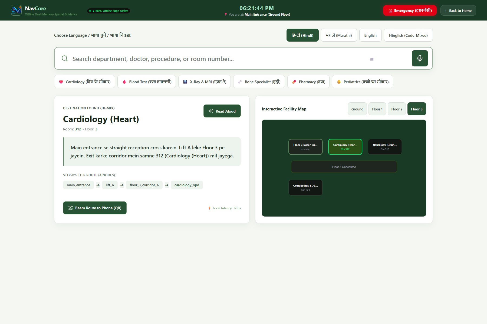
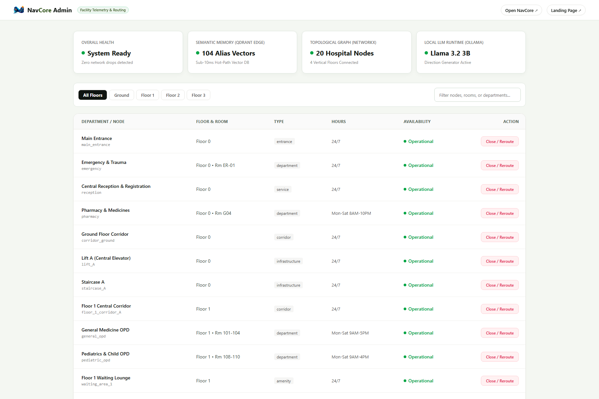
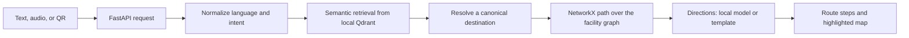

# NavCore

## Live API

**Railway:** [navcore-production-06ce08bd.up.railway.app](https://navcore-production-06ce08bd.up.railway.app)  
Health check: [`/health`](https://navcore-production-06ce08bd.up.railway.app/health) · Interactive API: [`/docs`](https://navcore-production-06ce08bd.up.railway.app/docs)

The hosted service runs without Ollama and uses deterministic template directions. The browser frontend is not hosted at this API URL.

**Offline-first, multilingual indoor navigation for complex public buildings.**

NavCore turns a visitor’s text or speech into a route through an indoor facility. It pairs multilingual semantic retrieval—which interprets phrases such as “heart specialist”—with a topological map that computes a physically connected route. The language model can explain the route; deterministic graph search chooses it.

> **Research prototype.** The included data models a sample hospital, not a live clinical facility. Do not rely on NavCore for patient care, emergency response, or safety-critical wayfinding without site-specific validation, accessibility review, and operational approval.

## At a glance

- **Local-first:** FastAPI, Qdrant local storage, embeddings, and route graph run on the edge device. Model downloads are needed during initial setup; cache the required models before operating offline.
- **Multilingual input:** English, Hindi, Marathi, and code-mixed Hindi-English queries.
- **Two kinds of memory:** semantic aliases map visitor language to facility locations; a graph represents walkable connections.
- **Deterministic routing:** NetworkX computes paths. Generative text may describe a path, but does not choose its graph edges.
- **Multiple ways to ask:** text, uploaded audio, or QR location input, with an interactive floor map and an administration screen.

## Product tour

| Navigation | Facility administration |
|---|---|
|  |  |

These images show the local sample application. The separate [search reference](artifacts/navcore-search-reference.png) and [route-map reference](artifacts/navcore-route-map-reference.png) show additional interface details.

## How a request becomes a route



Semantic memory handles what a visitor means. Topological memory handles where they can walk. This separation lets the system understand colloquial destination names without asking a language model to invent a path.

The current LangGraph workflow contains eight nodes: input processing, language detection, intent classification, retrieval, disambiguation, secondary destination resolution, path planning, and direction generation. The disambiguation node prepares candidate options but currently proceeds with the top candidate; a visitor selection turn remains future work.

For expanded diagrams, see [system architecture](artifacts/navcore-article-figures/system-map.svg), [live query flow](artifacts/navcore-article-figures/live-query-flow.svg), and [setup and update flow](artifacts/navcore-article-figures/build-and-update.svg).

## Benchmark snapshot

The checked-in 200-query evaluation covers 50 queries each in English, Hindi, Marathi, and code-mixed Hindi-English.

| Metric | Keyword baseline | Flat semantic | NavCore |
|---|---:|---:|---:|
| Destination accuracy | 39.0% | 76.0% | **76.0%** |
| Exact annotated path accuracy | No route | No route | **76.0%** |
| Junction next-edge accuracy | No route | No route | **77.86%** |
| Mean latency | Not measured | 105.61 ms | **108.88 ms** |
| P50 latency | Not measured | Not reported | **94.20 ms** |
| P95 latency | Not measured | Not reported | **163.33 ms** |

These are measurements on the documented benchmark setup, not a service-level guarantee. The run used CPU embeddings and template directions because Ollama was not running. Timings exclude model startup and browser/audio transcription. Metric definitions, run conditions, and per-query records are in [BENCHMARK.md](BENCHMARK.md) and [`evaluation/results/benchmark_results.json`](evaluation/results/benchmark_results.json); the query set is [`evaluation/test_set_200.json`](evaluation/test_set_200.json).

## Architecture

| Layer | Implementation | Responsibility |
|---|---|---|
| Interface | Next.js 14, React 18 | NavCore navigation, map, landing, and admin screens |
| API | FastAPI | Text, audio, QR, health, location, availability, and WebSocket endpoints |
| Workflow | LangGraph | Coordinates language, retrieval, disambiguation, routing, and directions |
| Semantic memory | `intfloat/multilingual-e5-small` + local Qdrant | Matches visitor phrases and aliases to facility nodes |
| Topological memory | NetworkX | Represents connections and computes shortest paths |
| Speech recognition | Whisper `tiny` | Transcribes uploaded audio locally after model setup |
| Optional wording | Ollama `llama3.2:3b` | Phrases a computed route; template directions are the fallback |

The sample facility contains 20 graph nodes and 104 semantic alias vectors. The system can initialize empty Qdrant collections during API startup; ingestion can also be run explicitly.

## Run locally

### Requirements

- Python 3.11 or newer
- Node.js 18 or newer
- FFmpeg for supported audio formats
- Internet access for first-time dependency and model downloads; cache the required assets before running offline
- Ollama is optional and only used for natural-language route wording

### 1. Install the backend

From the repository root:

```powershell
python -m venv .venv
.\.venv\Scripts\Activate.ps1
python -m pip install --upgrade pip
python -m pip install -r requirements.txt
```

Prepare the local vector collections explicitly if desired. The API also ingests automatically when its collections are empty.

```powershell
python -m ingestion.ingest
```

### 2. Start the API

In one terminal, from the repository root:

```powershell
python -m uvicorn api.main:app --host 127.0.0.1 --port 8001
```

The API initializes the graph and local retrieval pipeline on startup. The first run may download embedding and speech models. The health endpoint is available at `http://localhost:8001/health`.

### 3. Start the web interface

In a second terminal:

```powershell
cd frontend
npm ci
npm run dev
```

Open `http://localhost:3000`. The navigation interface is at `/navcore`; administration is at `/admin`.

### Optional: local direction wording

Install [Ollama](https://ollama.com), then download and run the configured model:

```powershell
ollama pull llama3.2:3b
ollama serve
```

NavCore continues to return template directions if Ollama is unavailable. It is never used to choose route edges.

## API surface

| Endpoint | Method | Purpose |
|---|---|---|
| `/query/text` | POST | Resolve a text query and calculate a route |
| `/query/audio` | POST | Transcribe an uploaded recording and navigate |
| `/query/qr` | POST | Resolve QR location input |
| `/health` | GET | Report graph, Qdrant, and optional Ollama status |
| `/locations` | GET | List facility locations |
| `/locations/{id}/availability` | PATCH | Update a location’s availability |
| `/ws/navcore` | WebSocket | Send live administration updates |

Example text request:

```bash
curl -X POST http://localhost:8001/query/text \
  -H "Content-Type: application/json" \
  -d '{"query":"where is cardiology","current_node":"main_entrance"}'
```

The response includes the destination, directions, detected language, route node sequence, confidence information, warnings, and disambiguation fields.

## Benchmark reproduction

Use a separate Qdrant path so a benchmark does not contend with a running API’s local database:

```powershell
$env:NAVCORE_QDRANT_PATH = "C:\path\to\navcore\qdrant_benchmark_storage"
python -m ingestion.ingest
python run_benchmark.py
```

The runner writes per-query and aggregate results to `evaluation/results/benchmark_results.json`. See [BENCHMARK.md](BENCHMARK.md) for the metric definitions and conditions behind the checked-in results.

## Citation & attribution

If you discuss NavCore in research or build upon this work, cite:

**Laukik Kishor Rathod** (2026). *NavCore: Offline Dual-Memory Spatial RAG for Multilingual Hospital Navigation.* GitHub: [github.com/Laukikrathod2007/NavCore](https://github.com/Laukikrathod2007/NavCore).

```bibtex
@software{rathod2026navcore,
  author  = {Rathod, Laukik Kishor},
  title   = {NavCore: Offline Dual-Memory Spatial RAG for Multilingual Hospital Navigation},
  year    = {2026},
  url     = {https://github.com/Laukikrathod2007/NavCore}
}
```

**Author:** Laukik Kishor Rathod<br>
**Institution:** JSPM RSCOE Pune | IIT Ropar Research Intern<br>
**Contact:** [rathodlaukik184@gmail.com](mailto:rathodlaukik184@gmail.com)<br>
**LinkedIn:** [linkedin.com/in/laukik-rathod-182337311](https://linkedin.com/in/laukik-rathod-182337311)

The 200-query dataset and benchmark result records are included in this repository. Any separate Hugging Face release should retain this citation and attribution.

## Use and permissions

**All rights reserved. No license to use, copy, modify, or redistribute this project is granted by making the repository public.** You must obtain prior written permission from the author before using any part of the project. Contact [rathodlaukik184@gmail.com](mailto:rathodlaukik184@gmail.com) to request permission, including for commercial use.

See [`LICENSE`](LICENSE). Public visibility on GitHub does not grant reuse permission. Third-party dependencies and models remain subject to their own licenses and terms.

## Repository map

```text
agents/       Query processing, retrieval, routing, and direction workflow
api/          FastAPI application and routes
core/         Embeddings, Qdrant, configuration, and spatial graph
data/         Sample hospital graph and multilingual aliases
evaluation/   Query set, baselines, metrics, and saved benchmark results
frontend/     Next.js interface
ingestion/    Facility graph and semantic index setup
plugins/      Facility-domain adapters
artifacts/    Technical article, diagrams, and interface captures
```
