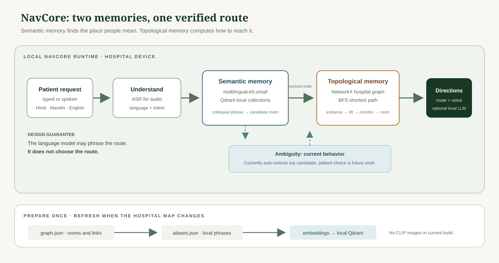
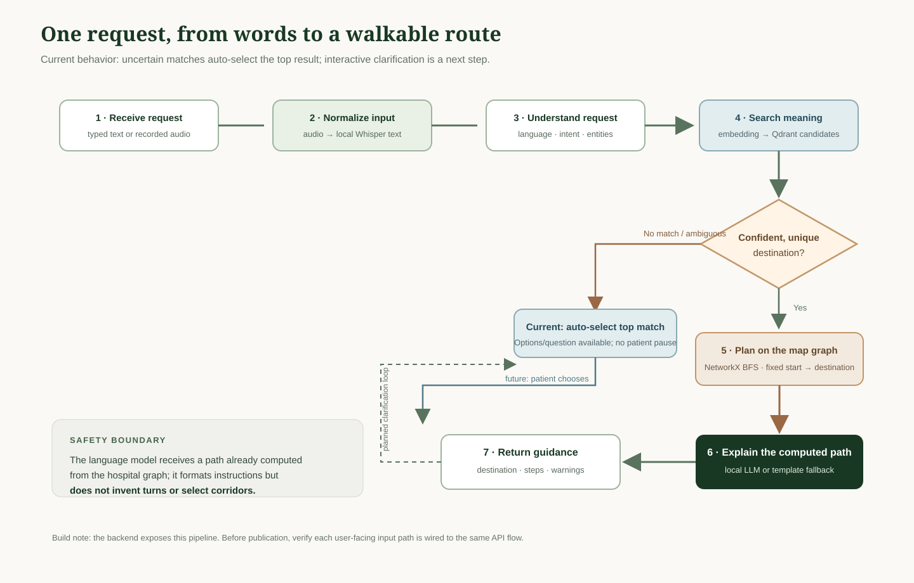
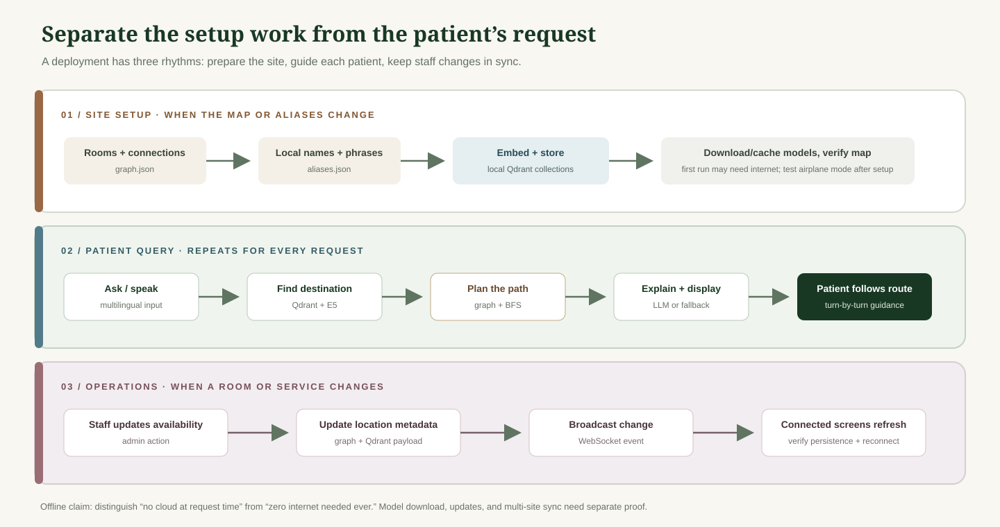

# A hospital wayfinder that can keep working without the cloud

**Working subtitle:** How NavCore combines multilingual search with a physical map graph to turn a patient’s words into a route through a hospital.

> **Draft status:** technically grounded article draft. Performance figures are intentionally withheld until the full benchmark is reproduced. See the publication checklist at the end.

## Opening: a question at the hospital entrance

“Where is the heart doctor?” is a simple question for a patient and a difficult one for a search box. The hospital directory may say “Cardiology OPD.” The patient may say “dil ke doctor,” “heart specialist,” or “Room 312.” A keyword search can miss the connection. And even after finding Cardiology, a system still has to know which lift and corridor lead there.

NavCore is an offline-first hospital navigation prototype built around those two separate jobs: understand the place the patient means, then calculate a route through a map of the building.

## The short version: two kinds of memory

NavCore keeps a **semantic memory** and a **topological memory**. Semantic retrieval maps different phrases to candidate hospital locations. A graph stores locations and their connections. Once a destination is selected, breadth-first search (BFS) computes a path through that graph. A language model can phrase the already-computed path; it does not choose the turns.

For a nontechnical reader: the first memory is like a multilingual receptionist who knows that “dil ke doctor” means cardiology. The second is the floor plan with doors, lifts, and corridors drawn as connected points. Knowing the name of a room does not tell you how to walk there; NavCore models both.

## Why not use one search engine for everything?

Vector similarity helps with language: it can find related meanings even when the wording is different. It does not know that a lift connects two floors, that a corridor branches left, or that a room is currently unavailable. A language model can write convincing directions, but fluent text is not proof that the route matches a building.

NavCore keeps those responsibilities separate:

1. **Find a destination candidate** from the patient’s language.
2. **Surface uncertainty.** The backend can form candidate options and a question, but currently auto-selects the top candidate; a real patient-response loop is still needed before claiming interactive clarification.
3. **Compute a path** from the known start location to the selected destination on the hospital graph.
4. **Explain that path** in the detected language, using a local model when available and a template fallback otherwise.

## What happens during one request?

The backend’s LangGraph workflow normalizes the input, detects language and intent, searches Qdrant, applies its current disambiguation behavior, optionally resolves a second destination, plans a graph path, and generates directions. For a voice request, the audio endpoint first transcribes the recording with Whisper, then sends the recognized text into the same navigation workflow. The disambiguation node can prepare choices and a question, but the initial implementation auto-resolves to the top candidate; it does not yet pause for the patient’s answer.

The route is the boundary that matters: the language model receives a path that has already been calculated. If the model is unavailable or too slow, the direction generator has a template fallback. That fallback should be measured and reviewed for every supported language before anyone relies on it in a hospital.

## Prepare the map once; answer requests many times

The sample hospital currently has a graph file and an aliases file. Ingestion embeds the location descriptions and aliases into local Qdrant collections. The API loads the graph into NetworkX. Those files are a sample dataset, not a verified map of a real hospital.

An offline claim needs a precise boundary. Model packages and model weights may need to be downloaded or installed before an air-gapped run. The query can then run locally if all required assets are present. Updates, backups, remote administration, and synchronizing multiple hospitals are separate features; “works without internet during a query” does not automatically mean “never needs internet.”

## Voice: speech is not the same as an audio embedding

NavCore’s live voice path is speech recognition, not image-style multimodal retrieval. The browser records audio. The local API passes the recording to Whisper to produce text. That text enters the same language, retrieval, and route pipeline as a typed request.

This is a practical design for a navigation question: the system searches for a **meaningful destination phrase**, not for a voice that sounds like a stored sample. NavCore interface now shows browser-provided interim captions when the browser supports them, while the final transcript and route come from the local API. The interim caption feature has a different privacy and offline boundary from local Whisper; verify its behavior in the target browser before describing the complete voice experience as air-gapped.

## What is in the current prototype?

- **FastAPI** exposes text, audio, QR, health, location, availability, and WebSocket endpoints.
- **multilingual-e5-small** produces 384-dimensional text embeddings.
- **Qdrant local mode** stores semantic and topological vectors on disk.
- **NetworkX** holds the sample indoor graph and computes shortest paths.
- **LangGraph** coordinates the navigation stages, including ambiguity handling.
- **Whisper tiny** handles audio transcription; the model must be installed locally.
- **Ollama / Llama 3.2 3B** is optional for phrasing directions; the code has a fallback.
- **Next.js** provides NavCore, admin interface, and a marketing site.

The repository also contains a 200-query evaluation set split across four language groups and documentation describing a comparison against keyword and flat-semantic baselines. Treat the published accuracy and latency figures as **reported, not reproduced for this draft**: the checked-in results JSON currently records only three queries per condition. Rerun the complete benchmark, inspect its outputs, and report hardware, model versions, timing boundaries, and per-language scores before making numerical claims.

## What we learned from a failed query

The recent voice bug is useful material for the article because it shows how a local system fails in practice. Whisper on CPU can take much longer than a short UI proxy timeout. A proxy may close its connection while the local API is still working. The useful fix was to send the recording directly to the local API, avoid blocking FastAPI’s async event loop during model work, and show interim transcript and processing states in the UI.

That does not establish a production-grade latency target. Record the actual time from microphone tap to final transcript and from transcript to route on the target hardware. Report cold start separately from warm requests. A live-caption animation is feedback, not evidence that the backend has finished.

## What still needs work before a real hospital deployment

1. **Connect every visible search path to the same backend.** The current landing sandbox and NavCore typed-search handler still use browser-side example resolution; the API pipeline exists separately. Demonstrate which screens are examples and wire real user-facing text queries through the backend before calling the full product end-to-end.
2. **Validate the map with a facility.** Replace the sample graph with a reviewed floor plan, accessible routes, stair/elevator behavior, room names, closures, and verified starting points. Ask hospital staff to check every route and direction.
3. **Reproduce evaluation results.** Run all 200 queries against each baseline, save the complete outputs, audit failed cases, and publish per-language metrics and a clearly defined latency measurement.
4. **Exercise speech in real conditions.** Test Hindi, Marathi, English, Hinglish, accents, room noise, microphone distance, browser support, cold model loading, and failure recovery. Distinguish interim browser captions from the final local Whisper transcript.
5. **Harden operations and privacy.** The prototype currently has broad CORS and no visible authentication on administrative availability updates. Keep it on a trusted local network for a demo; add access control, audit history, persistence, backup/restore, and a threat review before connecting it to a hospital network.
6. **Prove offline behavior.** Install and cache all models first, then disconnect the machine and verify text navigation, audio transcription, fallback directions, and admin behavior. Record what does and does not work without a connection.
7. **Document a reproducible install.** Pin tested dependencies, specify CPU/RAM/disk requirements, list model downloads and first-run steps, and provide a one-command health check.

## A reader-friendly article plan

To make the final article useful to more than developers, explain each idea at three levels: **patient view** (what the person sees), **operator view** (what staff maintains), and **developer view** (which component handles the work). Put the whole-system diagram before code. Follow it with the request flow, then map ingestion and live updates. Every diagram should have a caption, a plain-language reading guide, and a text alternative. Keep code excerpts short and link to full files.

Suggested sequence:

1. A patient asks for a department in their own words.
2. Why keyword search and free-form LLM routing are insufficient.
3. Two memories: semantic meaning versus physical connectivity.
4. A full query flow showing current auto-resolution and the patient clarification loop still to implement.
5. Setup/ingestion versus runtime and admin updates.
6. A real API request and response from a reproducible run.
7. Benchmark methodology, results, error cases, and limitations.
8. Offline boundary, privacy, hardware, setup, and next steps.

## Before publishing: fact-check checklist

- [ ] Re-run the full 200-query benchmark and reconcile the saved output with `BENCHMARK.md`.
- [ ] Confirm metric definitions and whether reported latency includes model startup, ASR, LLM generation, and browser/network overhead.
- [ ] Capture a current navcore screen and one successful typed and spoken end-to-end request.
- [ ] Mark the landing sandbox as a simulation or connect it to the API.
- [ ] Have a hospital-domain reviewer approve all sample routes and safety language.
- [ ] Verify which operations work after disconnecting the internet and which require prior downloads or a network.
- [ ] Add source links for model documentation, FastAPI, Qdrant local mode, graph algorithms, and any research claims.
- [ ] Remove patient-identifying details from logs and screenshots; do not use real patient data in examples.
- [ ] Publish the code repository URL, license, tested machine specifications, and exact setup commands.

## Closing

The useful idea in NavCore is not that a language model can give directions. It is that language understanding and physical route planning are different jobs, and the system gives each job a component suited to it. The next step is to validate that separation against a real floor plan, a complete evaluation run, and the offline conditions the article promises.

## Reference style

The supplied Smart Cart article is a useful model for pacing—problem, architecture, implementation walk-through, design decisions, measured limits, and next steps. Its CLIP image retrieval, retail catalogue, and Gemma recommendation flow are specific to that project and should not be copied into NavCore unless those features are actually built. [Smart Cart offline edge system article](https://pub.towardsai.net/how-to-build-a-smart-cart-kiosk-that-doesnt-need-the-cloud-clip-qdrant-edge-gemma-e7c02856350b)
