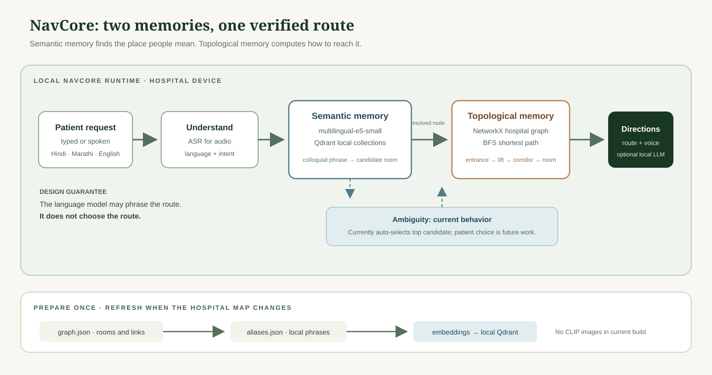
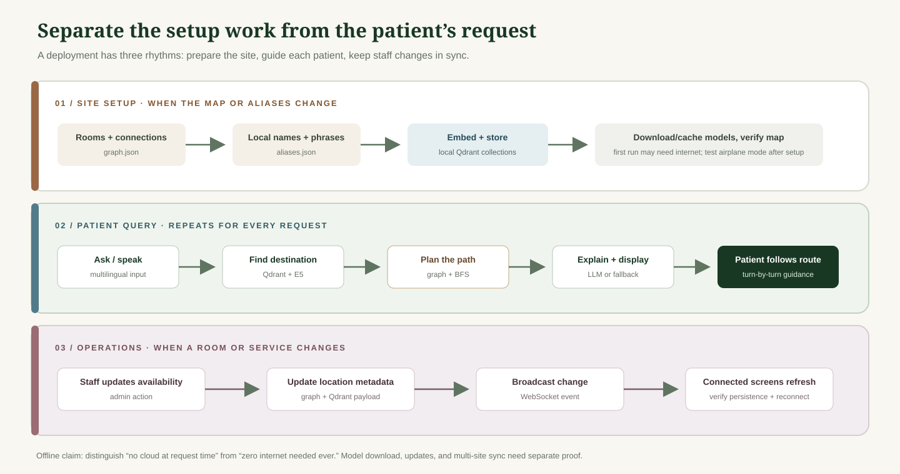
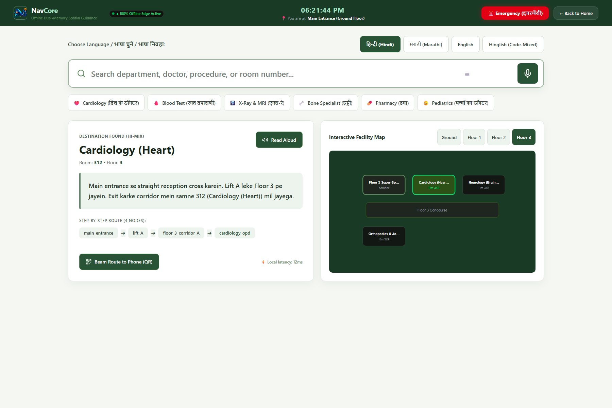
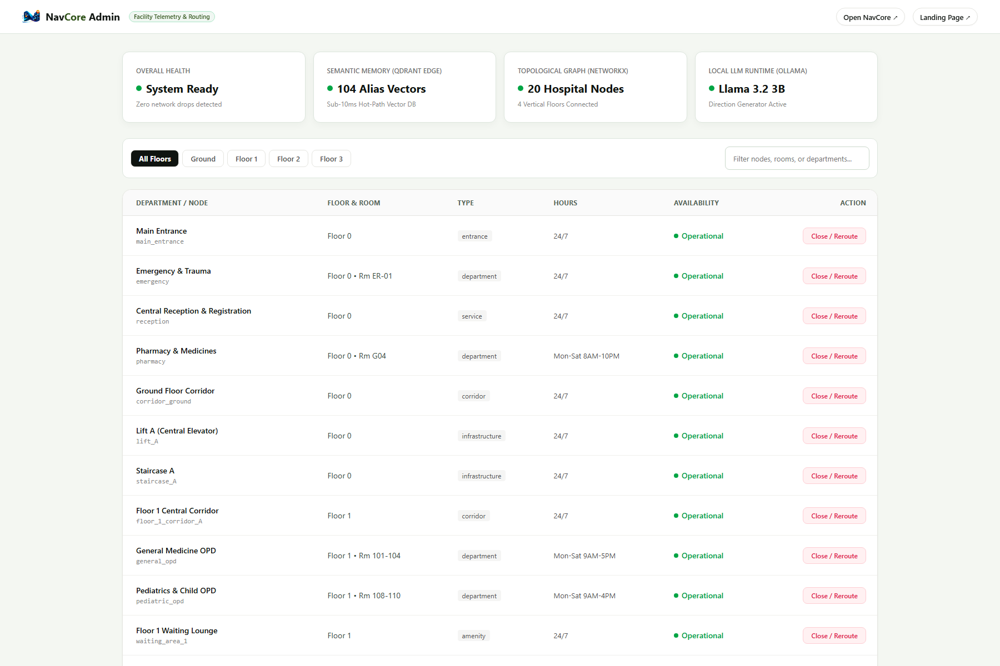
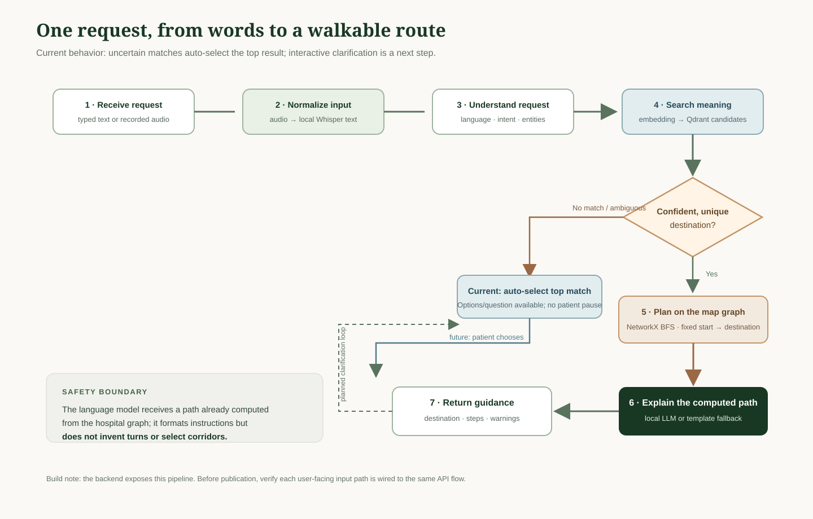

# A Hospital Wayfinder That Can Keep Working Without the Cloud

*How I built NavCore to connect multilingual search with a physical map graph, then measured the full workflow across four query-language groups.*

At a hospital entrance, a visitor may ask for “the heart doctor,” “dil ke doctor,” Cardiology OPD, or Room 312. The sign on the wall may use only one of those names. The visitor still needs more than a matching department label: they need to know which lift to take, which corridor to follow, and whether they have reached the right floor.

That small interaction is the problem I set out to solve with NavCore. I built a local first wayfinder that interprets multilingual requests and turns them into routes through an indoor map, without asking a language model to choose turns.

I evaluated the system against 200 queries in English, Hindi, Marathi, and code-mixed Hindi-English. NavCore matched the expected destination on 76% of the set, produced the exact annotated route on 76%, and selected the expected next edge at annotated junctions on 77.86%. Here is how I built it and what those numbers show.

## Why indoor navigation is a different search problem

A directory search and a route planner answer different questions. A directory search asks, “Which place does this phrase refer to?” A route planner asks, “How can someone move from here to that place?” A vector database can help with the first question. It does not know that Lift A connects the ground floor to Floor 3, or that a corridor branches near reception.

An LLM can write fluent instructions, but fluency does not establish that a route is physically valid. If it invents a turn at a junction, a patient may go the wrong way. A route needs to be grounded in the facility’s actual connectivity.

NavCore therefore separates meaning from movement. A semantic index finds candidate destinations from phrases and aliases. A graph represents walkable connections. Once the destination is resolved, NetworkX computes a shortest path by hop count. The direction generator can describe that fixed path; it does not select the path itself.

For a patient, this should feel like asking a receptionist and receiving step-by-step guidance. For a facilities team, it means maintaining a directory and a connected floor map. For a developer, it means the retrieval and routing components can be evaluated separately.

## The backbone: two memories, two jobs

I call this the dual-memory design. The first memory is semantic: it associates language with canonical places. The second is topological: it records which places connect. One might know that “dil ke doctor” means cardiology while the other knows how to get from the main entrance to Cardiology OPD.



In the sample route, `main_entrance` connects to `lift_A`, then `floor_3_corridor_A`, and finally `cardiology_opd`. The IDs are stable machine references. The graph nodes also hold presentation details such as display names, floors, room numbers, landmarks, and opening times. Those details let the route be expressed in language a visitor can use.

This design is related to broader work that separates semantic reasoning from explicit spatial structure. RAGNav describes a dual-basis memory for topological and semantic information; Floorplan2Guide studies graph-based floor-plan representations; and “Lost in Aggregation” analyzes where language models fail in multi-step maze navigation. These papers motivate design questions. They do not validate NavCore’s hospital routes or its benchmark.

## Architecture: prepare once, answer locally

NavCore has two operating phases. During setup, ingestion reads the facility graph and aliases, encodes the text, and stores vectors in local Qdrant collections. During a query, the API passes a request through a LangGraph workflow, retrieves candidate places, plans a path over the graph, and builds directions. The sample graph itself is loaded into NetworkX.



The ingestion code creates two collections. `topological_nodes` stores embeddings of each node’s display name and description, along with node metadata. `semantic_aliases` stores one embedding per alias and a payload with the canonical node ID. Keeping aliases separate avoids averaging phrases that may use very different wording. At query time, retrieval can return a phrase match and map it back to the same canonical destination.

This is an offline-first path after required model assets and data have been installed. It should not be described as “never needs internet”: initial package or model downloads may require a connection, and remote synchronization is a separate feature. The browser’s live interim speech captions also use browser speech recognition, which has different privacy and offline behavior from the local Whisper transcription endpoint.

## Why build this for a walk-up navigation interface?

The current target is hospital navigation because it brings together several constraints: visitors may not know official department names, may prefer Hindi or Marathi, may speak a mix of English and Hindi, may not have a smartphone, and may need help in a building where wireless coverage is uneven. A fixed NavCore interface is one possible interface for those conditions.

The FastAPI backend accepts text, audio, and QR location input. Its audio endpoint transcribes a recording with Whisper before sending the recognized words through navigation, and QR input can set the visitor’s current graph location. The NavCore interface’s typed searches and voice requests now use the backend, with the bundled sample resolver as a visible fallback if the API is unavailable. Backend text and audio requests can specify a starting node; otherwise, the API uses a location cookie or the configured default start node.

NavCore gives visitors one place to choose a language, ask by voice or text, and follow a highlighted floor map. The admin view gives staff a searchable facility list with availability controls. These screenshots were captured from the running local frontend:





The graph and aliases are sample hospital data. A real facility rollout can replace them with a reviewed floor map, validated accessible routes, tested audio, and staff-approved directions.

## The stack and why each piece is there

| Component | Current choice | Job |
|---|---|---|
| Workflow | LangGraph | Passes query state through input, language, intent, retrieval, ambiguity, secondary destination, path, and directions stages. |
| Embeddings | `intfloat/multilingual-e5-small` | Encodes multilingual aliases and queries into vectors. `core/config.py` sets the output dimension to 384. |
| Vector store | Qdrant local client | Searches semantic aliases and node descriptions from local storage. |
| Spatial graph | NetworkX | Holds the sample connectivity graph and computes shortest paths. |
| Speech recognition | OpenAI Whisper `tiny` model | Transcribes uploaded audio locally when the model is installed and available. |
| Directions | Optional Ollama `llama3.2:3b` | Phrases a precomputed route, with a template fallback if generation is unavailable or too slow. |
| API | FastAPI | Exposes navigation, QR, health, locations, and admin operations. |
| Interface | Next.js | Provides NavCore and administration screens. |

The chosen components reflect separation of responsibility. Qdrant is not asked to infer corridors. NetworkX is not asked to understand colloquial language. The LLM is not asked to invent a path. That split makes failures easier to diagnose: retrieval can select the wrong destination, the map can omit a connection, or the wording can be unclear, and those are distinct problems.

## Key implementation detail: aliases resolve to canonical places

An alias entry maps multiple human phrases to one node. The ingestion routine expands each alias into its own vector and saves the canonical ID and original alias text in its payload. Retrieval embeds the query and searches the semantic collection for up to `MAX_RETRIEVAL_CANDIDATES`, configured as 3.

The relevant payload shape is small:

```json
{
  "canonical_node_id": "cardiology_opd",
  "alias_text": "heart specialist"
}
```

The exact example above illustrates the schema, not a claim that this alias is present in the supplied sample data. The real alias file is the source of truth for phrases the prototype recognizes. In production, facility staff and local speakers should curate these aliases from real visitor language, including spelling variants and scripts.

The retrieval node uses two configured thresholds. A top cosine score below `LOW_CONFIDENCE_THRESHOLD` (0.40) triggers a rephrase response. Otherwise, a score below `DISAMBIGUATION_THRESHOLD` (0.85), or a small gap under `DISAMBIGUATION_GAP` (0.15) between the top candidates, marks the result ambiguous. These are prototype tuning values in `core/config.py`, not clinically or operationally validated cutoffs.

When retrieval flags ambiguity, the disambiguation node prepares a question and candidate options. The current NavCore flow resolves to the top candidate and continues; a future conversational turn can use the same response fields (`requires_disambiguation`, `disambiguation_question`, and `disambiguation_options`) to let the visitor choose before routing.

## Key implementation detail: the map, not the model, picks the route

The spatial graph loads nodes and their `connects_to` neighbors from JSON. `find_shortest_path` calls NetworkX shortest path and returns an ordered list of node IDs. If the start or destination does not exist, the graph raises a `KeyError`; if both exist but no route connects them, it returns an empty path.

```python
path = nx.shortest_path(self.graph, start, end)
```

That is the core safety boundary in the design: generated prose is downstream of the path. The code also identifies junctions as nodes with at least three neighbors and attaches nearby landmarks to nodes for grounded descriptions. In an equal-weight graph, shortest means the fewest graph edges. It does not automatically mean the easiest, accessible, or safest physical route. Elevators, closures, stairs, distance, construction, and wheelchair access need explicit modeling before path cost can represent those needs.

The direction generator builds compact route context, asks the local LLM for a short explanation when available, and falls back to a template when it cannot get a usable answer within the configured timeout. The fallback is currently English text. Each supported language needs separate review and testing so a model timeout does not silently reduce the usefulness of NavCore for a Hindi or Marathi speaker.

## Key implementation detail: speech enters the same navigation pipeline

The `/query/audio` route accepts an uploaded file, limits the body to 16 MiB, stores it temporarily, and calls transcription through FastAPI’s thread pool. It rejects empty or unclear recordings with structured errors, removes the temporary file, then invokes the same workflow with the transcribed text. The response adds `transcribed_text` to the normal navigation fields.

This interface is not a streaming speech-recognition protocol. The user interface may show interim browser captions, while the final transcript is produced by the backend upload and Whisper. Those are separate components and can disagree. A caption appearing on screen is not evidence that a route has been computed. The endpoint’s transcription and full-query latency must be measured on target NavCore hardware, including cold model load and noisy-room recordings.

## The agentic workflow: eight nodes, a limited role for generation

The workflow source defines eight nodes, despite older project documentation referring to seven. The current stages are:

1. **Input processor** normalizes input and handles audio/QR support functions.
2. **Language detector** selects among the supported language labels.
3. **Intent classifier** extracts the navigation intent and entities.
4. **Retrieval** searches Qdrant for candidate nodes and applies confidence thresholds.
5. **Disambiguation** prepares candidate options when retrieval flags ambiguity; as noted, it currently auto-selects the first candidate.
6. **Secondary resolver** can search for a second destination in a multi-stop request.
7. **Path planner** computes the route through the graph.
8. **Direction generator** turns the path into text, using Ollama if available and a template fallback otherwise.



The conditional edge after retrieval sends low-confidence cases to a rephrase response, ambiguous cases to disambiguation, and normal candidates to the secondary resolver. The secondary destination branch exists in the workflow, but it should be evaluated with dedicated cases before the article claims reliable multi-stop planning.

This is “agentic” in the modest orchestration sense: specialized stateful steps are wired together and choose conditional transitions. The workflow is not an autonomous agent with permission to take arbitrary actions. Its valuable constraint is that it uses deterministic graph planning for physical movement and treats language generation as presentation.

## The FastAPI backend: request and response shape

`POST /query/text` accepts a JSON body with a query, optional `current_node`, and optional language override. The location priority is request field, then `navcore_location` cookie, then the configured default start. `POST /query/audio` accepts a multipart file and optional current node. `POST /query/qr` parses a QR value and sets a location cookie. Other routes expose health, locations, availability updates, and NavCore WebSocket events.

Here is a reproducible text-query command based on the route’s actual request model:

```bash
curl -X POST http://localhost:8001/query/text \\
  -H "Content-Type: application/json" \\
  -d '{"query":"where is cardiology","current_node":"main_entrance"}'
```

The route handler returns JSON fields for `directions`, `destination`, `destination_node_id`, `detected_language`, `path_nodes`, `warnings`, `latency_ms`, confidence and disambiguation metadata, current location, and a possible path error. It also sets a location cookie when it has a path. Here is the actual response from a local `curl` request to the running API:

```json
{
  "directions": "Start at Main Entrance. Go to Lift A (Main) (near reception), turn here. Go to Floor 3 Corridor A (Floor 3) (near water_cooler_3), turn here. Your destination: Cardiology OPD, Room 312 (Open: Mon-Sat 9AM-2PM).",
  "destination": "Cardiology OPD",
  "destination_node_id": "cardiology_opd",
  "detected_language": "en",
  "path_nodes": ["main_entrance", "lift_A", "floor_3_corridor_A", "cardiology_opd"],
  "warnings": [],
  "latency_ms": 3367.89,
  "low_confidence": false,
  "rephrase_message": null,
  "is_multi_destination": false,
  "requires_disambiguation": true,
  "disambiguation_question": null,
  "disambiguation_options": null,
  "current_location_used": "main_entrance",
  "path_error": null
}
```

This response shows the resolved destination and the exact route returned to the client. Its timing is a live API request, including application overhead, and should be read separately from the post-startup workflow benchmark timing.

## Design decisions worth examining

### Keep vectors and paths separate

I chose vector retrieval for interpreting phrases and graph search for physical connectivity. A vector index is flexible with language but has no model of walkable edges. A graph can guarantee adjacency constraints in its data but cannot recognize that “heart specialist” refers to Cardiology. Each representation handles the kind of information it was designed for.

### Use explicit aliases instead of averaging phrases

The ingestion code stores one vector per alias. This preserves different utterance forms as independent search points and leaves the canonical node mapping explicit. The tradeoff is that alias quality and coverage matter: missing local phrases can still produce retrieval failures, and adding aliases requires a repeatable data update process.

### Use a local model only for language generation

The configured Ollama model is optional and has a finite timeout, followed by a template fallback. That supports a local-first deployment and avoids letting generated text control pathfinding. It also creates a quality tradeoff: fallback directions need translations and human review, and language-model output still needs checks for factual consistency with the route context.

### Prefer the shortest hop path for the prototype

Breadth-first shortest paths are easy to explain and deterministic on the unweighted sample graph. The design is intentionally simple for a prototype. For a real building, equal hop counts can represent very different walking distances or accessibility. Weighted edges and constraints should follow an approved facility model, not assumptions added to the algorithm.

## The benchmark: what the saved file actually shows

I ran all 200 queries in `evaluation/test_set_200.json` through each of the three conditions. The set is evenly split across English, Hindi, Marathi, and code-mixed Hindi-English. Results are saved query-by-query in `evaluation/results/benchmark_results.json`.

| Metric from 200-query run | Keyword baseline | Flat semantic | NavCore dual memory |
|---|---:|---:|---:|
| Queries recorded | 200 | 200 | 200 |
| Destination accuracy | 39.0% | 76.0% | **76.0%** |
| Exact path accuracy | No route produced | No route produced | **76.0%** |
| Junction next-edge accuracy | No route produced | No route produced | **77.86%** |
| Average latency | Not measured | 105.61 ms | **108.88 ms** |
| P50 latency | Not measured | Not reported | **94.20 ms** |
| P95 latency | Not measured | Not reported | **163.33 ms** |

| Language | Queries | Keyword | Flat semantic | NavCore |
|---|---:|---:|---:|---:|
| English | 50 | 60.0% | 88.0% | **88.0%** |
| Hindi | 50 | 40.0% | 66.0% | **66.0%** |
| Marathi | 50 | 0.0% | 74.0% | **74.0%** |
| Code-mixed Hindi-English | 50 | 56.0% | 76.0% | **76.0%** |

The headline result is that semantic retrieval finds the expected destination on 76% of this evaluation set, while the graph layer computes the exact expected path for those same 76%. At annotated junctions, the route takes the expected next edge 77.86% of the time. Keyword matching reaches 39% destination accuracy on the same examples. Flat semantic retrieval and NavCore have the same destination accuracy; the graph adds an explicit route and measurable turn decisions.

The junction score uses an explicit edge-level definition: for each annotated junction on the expected route, compare the predicted next node with the expected next node; a missing junction or route counts as incorrect. That makes 77.86% a direct measure of turn choice over the annotated junction decisions, rather than simply checking whether a route passed through a named junction. NavCore and the flat baseline had identical destination accuracy, so this run shows the contribution of route planning, not a retrieval-accuracy gain.

## What is next

The next stage is to build on this measurement. The next useful experiments include improving Hindi phrase coverage, investigating the cases where retrieval chose the wrong destination, and testing whether weighted routes better represent walking distance and accessibility. I’ll keep the query-level output so future changes can be compared against the same cases.

Second, replace the sample graph with a facility-reviewed map. Confirm each node, connection, floor transition, landmark, room label, accessible route, and closure procedure. Test paths with people who know the building and with visitors who did not help create the map. A map that is topologically connected can still be physically wrong.

Third, complete the patient clarification loop. When retrieval flags ambiguity, present the options, wait for the visitor’s selection, and re-run retrieval or resolve the chosen canonical ID before routing. Evaluate ambiguous names and low-confidence phrases explicitly. Do not silently route to the first candidate in a patient-facing deployment.

Fourth, measure voice in a realistic environment. Test supported languages, code mixing, accents, microphone distance, room noise, browser interim captions, and Whisper transcription separately. Report transcription quality and route success independently. Keep the distinction between browser-provided interim captions and local final transcription visible in privacy documentation.

Finally, harden operations. Review authentication and authorization for admin endpoints, persistent availability changes, audit history, backup and restore, logging privacy, CORS, and local-network exposure. Install all models before disconnecting and test which features keep working offline. A system can be offline during a query while still relying on internet for setup or updates.

## Numbers for people who like numbers

The current config selects `intfloat/multilingual-e5-small`, a 384-dimensional embedding; local collections named `topological_nodes` and `semantic_aliases`; Whisper `tiny`; Ollama model `llama3.2:3b` at `http://localhost:11434`; a maximum of 3 retrieval candidates; confidence thresholds of 0.40 and 0.85; a disambiguation score gap of 0.15; and a 2.5-second LLM timeout. The API defaults to port 8001 and starts from `main_entrance` when no other location is supplied.

On this run, NavCore averaged 108.88 ms per query, with a P50 of 94.20 ms and P95 of 163.33 ms after model startup. Flat semantic averaged 105.61 ms. These timings include workflow inference and template direction generation, and exclude model startup and browser/audio transcription. Ollama was unavailable during the run, so NavCore used the local template fallback for directions.

The run used CPU embedding inference and a locally cached multilingual E5 model. The numbers describe this machine, this sample hospital map, and this benchmark set; latency and speech behavior should be measured again on the hardware selected for a navcore.

## Closing

NavCore’s central idea is straightforward: understand the visitor’s words with semantic retrieval, then let a facility graph—not generated prose—determine the route.

## References

1. Luo and Bai, [“RAGNav: A Retrieval-Augmented Topological Reasoning Framework for Multi-Goal Visual-Language Navigation”](https://arxiv.org/abs/2603.03745), 2026.
2. Jiang, Luo, and Meng, [“Lost in Aggregation: A Multi-Scale Diagnostic Benchmark for LLM Spatial Navigation”](https://arxiv.org/abs/2606.22219), 2026.
3. Ayanzadeh and Oates, [“Floorplan2Guide: LLM-Guided Floorplan Parsing for BLV Indoor Navigation”](https://arxiv.org/abs/2512.12177), 2025.
4. Wang et al., [“Multilingual E5 Text Embeddings: A Technical Report”](https://arxiv.org/abs/2402.05672), 2024.
5. More et al., [“IndicRAGSuite: Large-Scale Datasets and a Benchmark for Indian Language RAG Systems”](https://arxiv.org/abs/2506.01615), 2025.
6. [FastAPI documentation](https://fastapi.tiangolo.com/), [Qdrant documentation](https://qdrant.tech/documentation/), [NetworkX shortest paths](https://networkx.org/documentation/stable/reference/algorithms/shortest_paths.html), and [LangGraph documentation](https://docs.langchain.com/oss/python/langgraph/overview).
7. [Smart Cart offline edge system article](https://pub.towardsai.net/how-to-build-a-smart-cart-kiosk-that-doesnt-need-the-cloud-clip-qdrant-edge-gemma-e7c02856350b), used as a structural writing reference.
